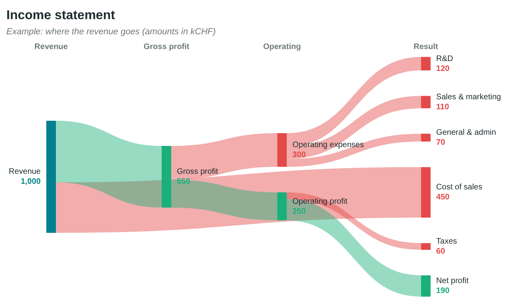

# ZenSankey

**Sankey diagrams in Excel and PowerPoint, drawn as native, editable shapes.**

ZenSankey is a pair of VBA add-ins (`.xlam` for Excel, `.ppam` for PowerPoint) that turn a
simple `Source | Target | Amount` table into a Sankey diagram made of real Office shapes:
curved bands, nodes, labels, titles. No picture, no web service, no data leaving your computer.
The result is a grouped shape you can resize, recolor and retouch like any other object, and
copy from Excel to PowerPoint without losing anything.



## Features

- Works in **Excel** (from a selected range) and **PowerPoint** (from a table or a text box).
- **Native shapes**: every band, node and label is editable; the whole diagram is one group.
- Automatic layout: columns from the flow structure, sinks pushed to the right, node ordering
  that reduces crossings, proportional heights, optional forced columns.
- **Good-looking by default**: flat translucent bands, colors that follow the main flow
  (branches get their own accent color), labels measured on the real text so nothing overlaps,
  balanced column spacing.
- **Style from the ribbon**: palette, colors, band color and opacity, shape, node width,
  labels, font, number format, unit, title, subtitle, section titles, background... Every
  change is applied immediately to the selected diagram. No settings sheet, no code.
- **Update**: change the table, click Update, the diagram is redrawn in place.
- Tolerant number parsing (`3 000`, `3'000`, `2 650,5`, `1,234.5`).
- Windows and macOS, Office 2016 and later (Microsoft 365 included). No installation of anything
  else, no administrator rights.

## Installation

Download `ZenSankey.xlam` and `ZenSankey.ppam` from the [`dist`](dist) folder or from the
[Releases](../../releases) page, then follow one of the methods below.

### Windows, scripted

1. Close Excel and PowerPoint.
2. Open a PowerShell window in the folder that contains the add-ins and run:

   ```powershell
   powershell -ExecutionPolicy Bypass -File install\install-windows.ps1
   ```

   The script copies the add-ins to `%APPDATA%\Microsoft\AddIns`, unblocks them and registers
   them for Excel and PowerPoint. Use `-Uninstall` to remove them.

### Windows, manual

1. Right-click each downloaded file > **Properties** > tick **Unblock** > OK.
2. Move the files to a permanent folder (for example `%APPDATA%\Microsoft\AddIns`).
3. Excel: **File > Options > Add-ins**, at the bottom choose **Excel Add-ins** > **Go…** >
   **Browse…**, select `ZenSankey.xlam`, tick it.
4. PowerPoint: **File > Options > Add-ins**, choose **PowerPoint Add-ins** > **Go…** >
   **Add New…**, select `ZenSankey.ppam`, accept the macro prompt.

### macOS

1. Run `bash install/install-macos.sh` (copies the files to the Office add-ins folder and
   removes the quarantine flag), or copy them yourself to
   `~/Library/Group Containers/UBF8T346G9.Office/User Content.localized/Add-Ins.localized/`.
2. Excel: **Tools > Excel Add-ins…**, tick **ZenSankey** (or **Browse…** to the file).
3. PowerPoint: **Tools > PowerPoint Add-ins…**, click **+**, choose `ZenSankey.ppam`.

### Try it without installing

The `dist` folder also contains `ZenSankey-test.xlsm` and `ZenSankey-test.pptm`: a
workbook and a presentation that embed the same macros and ribbon. Open one, enable macros,
and use the **ZenSankey** tab.

### If macros are blocked

Organisations often restrict macros. If the ZenSankey tab does not appear or the buttons do
nothing, add the folder that contains the add-ins to the **Trusted Locations**
(File > Options > Trust Center > Trust Center Settings > Trusted Locations), or ask your IT
department. The add-ins contain no external calls and no network access; the source code is in
[`src`](src).

## Usage

### Excel

1. Build a table with one row per flow: **Source | Target | Amount**. A header row is optional.
   Three optional columns can follow: **Color** (`#RRGGBB`, forces the color of that band and
   of its target node), **Source column** and **Target column** (0 = first column; forces the
   horizontal position of a node).
2. Select the table and click **ZenSankey > Draw Sankey**. The diagram appears to the right of
   the selection as a group named `Sankey hhmmss`, sized so that every label fits.
3. Adjust the look with the ribbon controls (see below) while the diagram is selected: it is
   redrawn immediately. **Example** inserts a sample table (income statement) and draws it.
4. After changing the table, select the diagram and click **Update**.

### PowerPoint

1. Insert a table with the same columns (**Insert > Table**, or paste cells copied from Excel),
   or a text box with one flow per line in the form `Source [amount] Target`
   (`Source ; Target ; amount` and tab-separated lines also work).
2. Select the table or the text box and click **ZenSankey > Draw Sankey**. The diagram is placed
   below the table when there is room, otherwise in the content area of the slide; the text is
   scaled down if needed so that the diagram fits the slide.
3. Adjust the look with the ribbon controls while the diagram is selected. Keep the source table
   (it can be moved off the slide) if you want to use **Update** later.

### Editing the result

The diagram is a plain group of shapes: resize it, move labels, change a color, copy it into
another document. Resizing the group and clicking **Update** redraws it at the new size.

## Ribbon controls

| Group | Control | Effect |
|---|---|---|
| Diagram | **Draw Sankey** | Draws from the selected table; with a diagram selected, redraws it |
| | **Update** | Redraws the selected diagram from its source table with the current style |
| | **Example** | Inserts a sample table and draws it |
| Style | Palette | `Teal` (default), `Vivid`, `Pastel`, `Muted`, `Ocean`, `Warm`, `Mono` |
| | Colors | `Follow the flow` (a node keeps the color of its main source, branches get new colors), `One per node`, `One per column` |
| | Links | Band color: `Target color` (default), `Source color`, `Gradient`, `Gray` |
| | Opacity | Band opacity, 25 % to 100 % (default 45 %) |
| | Shape | `Curved`, `Soft curve`, `Straight` |
| | Nodes | Node bar width: thin to extra wide |
| | Rounded nodes, Band outline | Rounded node corners; thin white outline around bands |
| Labels | Show | `Name and value`, `Name only`, `Value only`, `No labels` |
| | Size, Font | Label font size (8 to 18) and font |
| | Format, Decimals, Unit | `Standard`, `Thousands (k)`, `Millions (M)`, `Percent` (of the first column); decimals; unit text |
| | Outside labels | Labels of the first and last columns outside the band area |
| | Values on bands | Amount written on bands that are tall enough |
| | Label background | Translucent white box behind labels |
| Titles | Title, Subtitle, Sections | Title, subtitle and section titles above the columns (separated by `;`, e.g. `Sources;Allocation;Result`); press Enter to apply |
| | Background | Light rounded background behind the diagram |
| More | Order | Vertical order of the nodes: automatic (fewer crossings) or as in the table |
| | **Reset style** | Back to the defaults |

The style is stored with each diagram, so selecting an old diagram and changing one control
keeps its other settings. The full list of style keys (also usable from VBA through
`SkSetOption`) is in [`docs/options.md`](docs/options.md).

## Building from source

The add-ins are built from the `.bas` files in `src/` with LibreOffice as the VBA compiler
and a Python packaging step. See [`docs/building.md`](docs/building.md). To contribute, read
[`CONTRIBUTING.md`](CONTRIBUTING.md).

## Troubleshooting

See [`docs/troubleshooting.md`](docs/troubleshooting.md) for the common cases: tab missing,
macros disabled, error messages, accents, large diagrams.

## License and attribution

ZenSankey is released under the [Apache License 2.0](LICENSE).
Copyright (c) 2026 **Samuel Mellot**, original author. The [`NOTICE`](NOTICE) file carries the
attribution and must be kept in redistributions and derivative works, including forks
(Apache License 2.0, Section 4). See also [`AUTHORS.md`](AUTHORS.md) and
[`CITATION.cff`](CITATION.cff).
